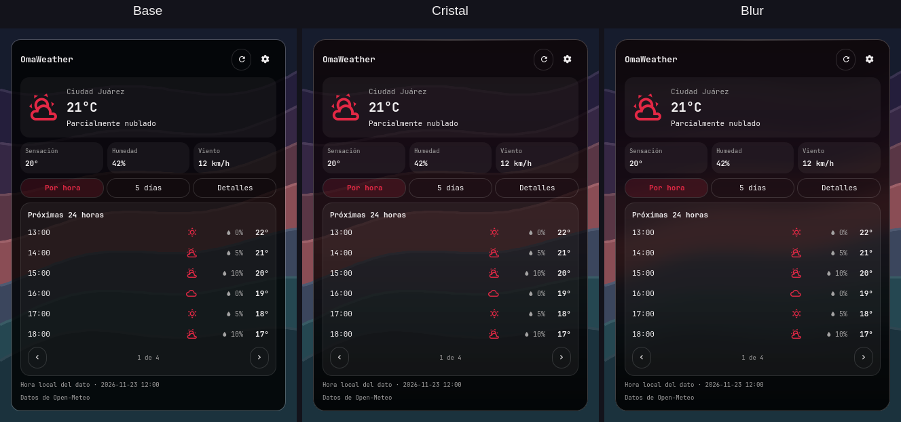
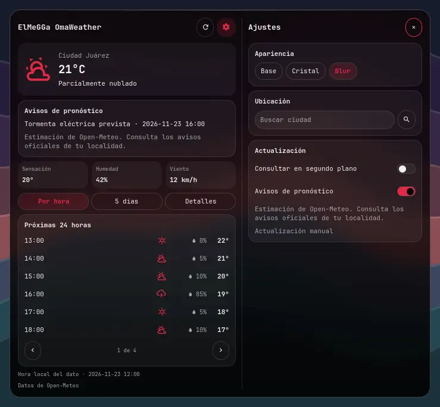

# OmaWeather

Clima para la barra de Omarchy. Consulta las condiciones actuales, las próximas 24 horas, el pronóstico de cinco días y detalles como viento, humedad y radiación UV. Está disponible en español e inglés.



*Paneles renderizados con datos de ejemplo y la paleta Rubí OLED. El desenfoque del fondo está simulado en la captura.*

## Funciones

- Temperatura y estado del tiempo en la barra y condiciones actuales en el panel.
- Pronóstico de las próximas 24 horas en páginas de seis horas, con temperatura y probabilidad de lluvia.
- Pronóstico de cinco días con mínimas, máximas y condiciones.
- Detalles de sensación térmica, humedad, viento, ráfagas, presión, nubosidad, visibilidad, UV, precipitación, amanecer y atardecer.
- Búsqueda de ciudades, actualización manual y consultas automáticas opcionales cada 5, 15, 30 o 60 minutos.
- Interfaz en español e inglés, hora local del dato y última lectura disponible si falla una consulta.

## Instalación y uso

Requiere Omarchy con el shell Quattro, Python 3, `curl` y conexión a internet.

```sh
omarchy plugin add https://github.com/megga-ernesto/omaweather.git --enable
```

Abre el panel desde la barra y pulsa el engranaje. En **Ubicación** busca una ciudad y selecciona un resultado. En **Actualización** elige si deseas consultas en segundo plano y con qué frecuencia. El botón de actualizar del panel permite consultar al momento.

## Apariencia

Elige un acabado en **Ajustes → Apariencia**.

| Acabado | Apariencia |
|---|---|
| **Base** | Adopta el fondo, la transparencia y las reglas de composición de los paneles de Omarchy. |
| **Cristal** | Aplica un degradado traslúcido con 6 %, 3 % y 0 % de acento del tema, de arriba abajo. |
| **Blur** | Usa el mismo degradado y difumina el escritorio detrás del panel si Hyprland lo permite. |

Si Hyprland no puede aplicar Blur, el panel muestra Cristal y explica el motivo en Apariencia.



## Datos

La búsqueda envía el nombre de la ciudad a Open-Meteo. El pronóstico envía las coordenadas guardadas de la localidad elegida. El dato se muestra con su hora local y el panel identifica la última lectura disponible ante un error.

## Actualizar o quitar

```sh
omarchy plugin update elmegga.omaweather
omarchy plugin disable elmegga.omaweather
omarchy plugin remove elmegga.omaweather
```

## Desarrollo local

Desde la raíz del repositorio, ejecuta:

```sh
omarchy plugin validate .
```

Para probarlo en Quattro, copia los archivos del plugin, incluida la carpeta `i18n`, a `~/.config/omarchy/plugins/elmegga.omaweather/`. Omarchy detecta el manifiesto y permite habilitar el widget con `omarchy plugin enable elmegga.omaweather`.

## Créditos y licencia

Pronósticos y búsqueda de ciudades por [Open-Meteo](https://open-meteo.com/). Los componentes compartidos `Oma*.qml`, `OmaColors.js` y `backdrop.py` conservan su [licencia MIT](docs/mit-shared-components.txt).
